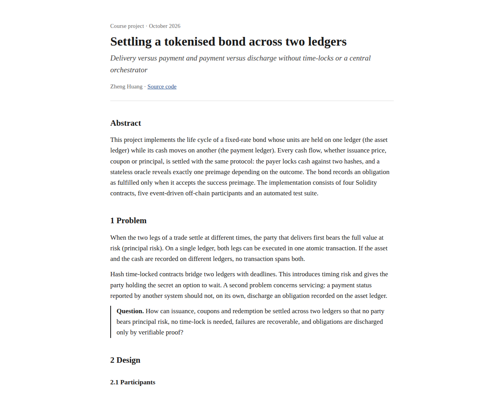

# Settling a tokenised bond across two ledgers

A fixed-rate bond whose units live on an asset ledger while its
cash moves on a separate payment ledger. Issuance, coupons and redemption are
settled with one protocol: the payer locks cash against two hashes, a stateless
oracle reveals exactly one preimage depending on the outcome, and the bond
records an obligation as fulfilled only when it accepts the success preimage.



## Run

Requirements: Node.js 20 or 22 and npm.

```bash
npm install
npm run demo     # project page with live demonstration: http://127.0.0.1:3000
npm test         # 54 tests
npm run lab      # the same life cycle in the terminal
```

Further views: `/lab` (role-based dashboard), `/modules` (earlier modules).

## Design

- `SmartBondFactory`: the issuer publishes indicative coupons per tenor and admits
  investors; each trade request deploys one `SmartBondContract`.
- `SmartBondContract`: explicit state machine
  (IndicationPhase → TradeIncepted → DistributionPhase → IsinAssigned → Minted →
  Issued → Redeemed); the investor confirms the hash of a structured terms record;
  every cash flow uses the same settlement protocol.
- `BondToken`: deployed and minted by the registrar; only the bond contract moves
  or burns units.
- `CashLock`: payment-ledger model of a hash-locked cash account.
- Off-chain participants (ISIN agent, registrar, decryption oracle, issuer and
  investor connectors) react to on-chain events with their own keys; there is no
  central orchestrator.

Properties and their tests are listed on the project page (section 5).

## Structure

```text
contracts/lab/            Factory, bond instance, bond token, cash lock
scripts/lab/              Participants, human actions, terminal demo, code excerpts for the page
scripts/lib/erc7573.js    Key documents, encryption, stateless oracle
test/lab/                 Life cycle, state x role, protections
public/project.*          Project page

contracts/, test/         Earlier modules: same-ledger DvP (DvPSettlement),
                          two-ledger DvP with an asset lock (AssetLockingContract,
                          PaymentDecryptionContract), coupon discharge (CouponDischarge)
```

## Limitations

Local in-memory ledgers only; the payment ledger is a model, not a payment
system. No legal register or real identifiers. A single oracle key (single point
of trust and liveness dependency). Cash-lock attestation by the payee is a design
assumption. One investor per instance, no secondary trading, regular annual
coupon periods only. Not audited.

## References

1. BIS CPSS (1992). *Delivery versus payment in securities settlement systems.*
2. ERC-20: Token Standard. https://eips.ethereum.org/EIPS/eip-20
3. ERC-6123: Smart Derivative Contract (draft). https://eips.ethereum.org/EIPS/eip-6123
4. ERC-7573: Conditional-upon-Transfer-Decryption for DvP (draft). https://eips.ethereum.org/EIPS/eip-7573
5. ICMA. *Bond Data Taxonomy.*
6. Gesetz über elektronische Wertpapiere (eWpG), 2021.

## License

MIT. No warranty.
